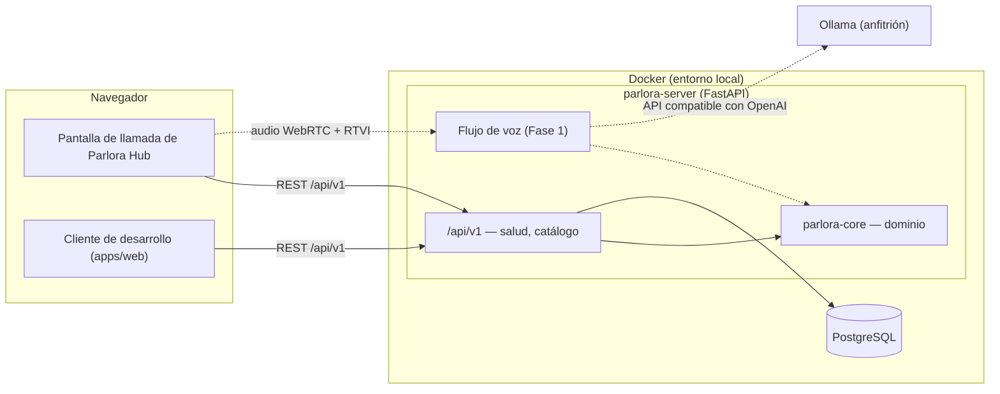

# Parlora Tutor

**Un motor de tutor por voz, local, para practicar idiomas hablando.**

[](https://github.com/Mvh18/parlora-tutor/actions/workflows/ci.yml)
[](https://scorecard.dev/viewer/?uri=github.com/Mvh18/parlora-tutor)
[](LICENSE)

[English](README.md) · Español

> 🚧 **En desarrollo.** Parlora Tutor está en su primera fase: el esqueleto
> del proyecto (núcleo de dominio, API versionada, entorno local, cliente de
> desarrollo y controles de calidad) ya está listo, y lo siguiente es el flujo
> de voz. El inglés es el primer idioma de práctica; habrá más.

## Qué es y por qué

Parlora Tutor es el motor de IA de voz de Parlora: hablas en voz alta con un
compañero de conversación que se adapta a tu nivel MCER (A1–C2) y te corrige
por escrito, para que las correcciones nunca corten la conversación. El
reconocimiento de voz, el modelo de lenguaje y la síntesis de voz se ejecutan
en tu propio equipo.

Es un motor, no una aplicación. Expone una API HTTP versionada (y, desde la
Fase 1, un canal de voz WebRTC) que consume un producto para el alumno:
Parlora Hub, la plataforma de cursos, construye su pantalla de llamada sobre
él. Para desarrollo, pruebas y demos, Tutor incluye un cliente mínimo de una
sola página.

## Privacidad ante todo

- **Local por defecto**: el reconocimiento de voz, el modelo de lenguaje y la
  síntesis de voz corren en tu hardware. Tu voz y tus transcripciones nunca
  salen de tu equipo, y no hay telemetría.
- **Sin datos de identidad**: Tutor solo conoce al alumno por una referencia
  opaca que elige la plataforma integradora; rechaza correos electrónicos
  como referencia.
- **Solo en local**: todos los puertos del entorno local se publican en
  `127.0.0.1`. El acceso desde la red local será una opción explícita.
- **Datos de prueba sintéticos**: el repositorio nunca contiene grabaciones
  de voz reales; el audio de prueba es generado y vive en
  `fixtures/synthetic/`.

## Arquitectura



Las líneas discontinuas están planificadas. El núcleo de dominio no depende
de ningún framework y el servidor es un adaptador fino a su alrededor; ver
[docs/architecture.md](docs/architecture.md) (en inglés) y los
[registros de decisiones](docs/adr/).

## Requisitos de hardware

| Componente | Mínimo                                                        | Recomendado (equipo objetivo)                      |
| ---------- | ------------------------------------------------------------- | -------------------------------------------------- |
| GPU        | ninguna para el esqueleto (modo `nogpu`)                      | NVIDIA con 8 GB de VRAM, p. ej. RTX 4060           |
| RAM        | 8 GB                                                          | 16 GB                                              |
| Sistema    | Windows 11 (WSL2), Linux o macOS                              | Windows 11 con Docker Desktop (WSL2)               |
| Software   | Docker, git, [uv](https://docs.astral.sh/uv/), Node.js 24 LTS | más el driver de NVIDIA con soporte de GPU en WSL2 |

Todo lo que usará la GPU en fases posteriores (Whisper y el modelo de
lenguaje) está dimensionado para caber en 8 GB de VRAM; la síntesis de voz
corre en la CPU.

## Inicio rápido

```sh
git clone https://github.com/Mvh18/parlora-tutor.git
cd parlora-tutor
uv run just setup        # instala dependencias desde los lockfiles y los git hooks
uv run just up           # arranca PostgreSQL y el servidor; `uv run just up nogpu` sin GPU NVIDIA
```

El servidor escucha en <http://127.0.0.1:8700>:

- <http://127.0.0.1:8700/api/v1/health/ready>: disponibilidad, incluida la base de datos
- <http://127.0.0.1:8700/api/v1/languages>: el catálogo de idiomas
- <http://127.0.0.1:8700/api/v1/docs>: documentación interactiva de la API

Arranca el cliente de desarrollo con `pnpm --dir apps/web dev` y abre
<http://localhost:3000>. Detén el entorno con `uv run just down`. La
configuración es opcional; copia [.env.example](.env.example) a `.env` para
cambiarla.

## Estructura del proyecto

```text
packages/core/       parlora-core — dominio sin frameworks (idiomas, MCER, sesiones, puertos)
apps/server/         parlora-server — app FastAPI, errores RFC 9457, línea base de Alembic
apps/web/            @parlora/web — cliente de desarrollo mínimo (Vite + React)
contracts/           openapi.json — el contrato de la API, versionado
docker/, compose*.yaml   entorno local (imagen del servidor, PostgreSQL, Ollama opcional)
tests/repo/          pruebas de invariantes del repositorio
scripts/             utilidades de desarrollo multiplataforma (Python)
docs/                arquitectura, registros de decisiones, ajustes del repositorio
```

## Desarrollo

Las recetas se ejecutan con [just](https://just.systems/), que instala uv,
así que los mismos comandos funcionan en PowerShell y en bash. También hay un
[Dev Container](.devcontainer/) con todas las herramientas.

| Comando                  | Qué hace                                                      |
| ------------------------ | ------------------------------------------------------------- |
| `uv run just setup`      | Instala dependencias y los git hooks                          |
| `uv run just dev`        | Arranca el entorno con recarga del servidor al cambiar código |
| `uv run just fmt`        | Formatea Python y todo lo que gestiona Prettier               |
| `uv run just lint`       | Lint, formato y contratos de importación                      |
| `uv run just typecheck`  | mypy `--strict` y `tsc`                                       |
| `uv run just openapi`    | Exporta el contrato de la API a `contracts/openapi.json`      |
| `uv run just gen-client` | Regenera el cliente TypeScript a partir del contrato          |
| `uv run just security`   | Secretos, auditoría de workflows y de dependencias            |
| `uv run just check`      | Todos los controles que ejecuta CI                            |

## Pruebas

| Suite             | Comando                   | Umbral                                      |
| ----------------- | ------------------------- | ------------------------------------------- |
| Núcleo            | `uv run just test-core`   | ≥ 95 % de líneas y ramas                    |
| Servidor          | `uv run just test-server` | ≥ 85 %; las de integración necesitan Docker |
| Web               | `uv run just test-web`    | ≥ 85 % en todas las métricas                |
| Extremo a extremo | `uv run just e2e`         | Smoke de Playwright con axe (tras `up`)     |
| Repositorio       | `uv run just test-repo`   | Invariantes, documentación y enlaces        |

`uv run just test` ejecuta todas las suites salvo la de extremo a extremo.
Las pruebas marcadas `gpu` se excluyen en CI.

## Hoja de ruta

| Fase | Objetivo                                                     | Estado         |
| ---- | ------------------------------------------------------------ | -------------- |
| 0    | Esqueleto del proyecto y benchmarks de componentes           | 🔵 En curso    |
| 1    | Bucle de voz mínimo: hablar y oír una respuesta              | ⚪ Planificada |
| 2    | Comportamiento de tutor: conversación adaptada al nivel MCER | ⚪ Planificada |
| 3    | Correcciones escritas en paralelo a la conversación          | ⚪ Planificada |
| 4    | Vista de llamada en el cliente de desarrollo                 | ⚪ Planificada |
| 5    | Persistencia de sesiones y resumen final (API)               | ⚪ Planificada |
| 6    | Calidad y optimización de latencia                           | ⚪ Continua    |
| 7    | Integración con Parlora Hub                                  | ⚪ Planificada |
| 8    | Extras del motor                                             | ⚪ Opcional    |

## Capturas de pantalla

_Llegarán con el bucle de voz._

## Cómo contribuir

Las contribuciones son bienvenidas. Lee primero
[CONTRIBUTING.md](CONTRIBUTING.md) (en inglés): todo cambio parte de un
issue, la lógica de dominio se escribe con las pruebas primero y los commits
siguen Conventional Commits. Antes de que se fusione tu primer pull request,
aceptas una sola vez el [Acuerdo de Licencia de Contribuidor](CLA.md). Todos
seguimos el [Código de Conducta](CODE_OF_CONDUCT.md). Informa de
vulnerabilidades de forma privada como indica [SECURITY.md](SECURITY.md);
para pedir ayuda, ver [SUPPORT.md](SUPPORT.md).

## Licencia

Parlora Tutor es **de código disponible** (_source-available_) bajo la
[PolyForm Noncommercial License 1.0.0](LICENSE). En pocas palabras:

- Puedes usarlo, estudiarlo, modificarlo y compartirlo con cualquier fin
  **no comercial**: estudio personal, docencia, investigación o una
  organización sin ánimo de lucro.
- **No** puedes usarlo comercialmente (por ejemplo, en un producto o
  servicio de pago) sin una licencia aparte.
- No es "código abierto" en el sentido de la OSI, porque la licencia no
  permite el uso comercial.

Para una licencia comercial, escribe a **team.parlora@gmail.com**.

Copyright © Marlon Vásquez Herrera. Los componentes de terceros conservan sus
propias licencias; ver [NOTICE](NOTICE).

## Agradecimientos

Parlora Tutor se apoya en el trabajo de muchos proyectos, entre ellos
[Pipecat](https://github.com/pipecat-ai/pipecat),
[faster-whisper](https://github.com/SYSTRAN/faster-whisper) y
[Whisper](https://github.com/openai/whisper) de OpenAI,
[Kokoro](https://huggingface.co/hexgrad/Kokoro-82M) y
[misaki](https://github.com/hexgrad/misaki),
[Silero VAD](https://github.com/snakers4/silero-vad),
[Ollama](https://ollama.com/), [FastAPI](https://fastapi.tiangolo.com/),
[uv](https://docs.astral.sh/uv/) y [Vite](https://vite.dev/). Sus licencias
están en [NOTICE](NOTICE).
