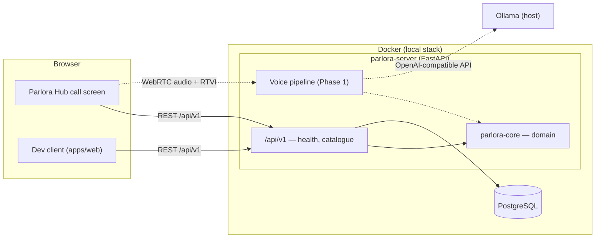

# Parlora Tutor

**A local-first voice tutor engine for practising spoken languages.**

[](https://github.com/Mvh18/parlora-tutor/actions/workflows/ci.yml)
[](https://scorecard.dev/viewer/?uri=github.com/Mvh18/parlora-tutor)
[](LICENSE)

English · [Español](README.es.md)

> 🚧 **Work in progress.** Parlora Tutor is in its first phase: the project
> skeleton (domain core, versioned API, local runtime, dev client and quality
> gates) is in place, and the voice pipeline comes next. English is the first
> target language; more are planned.

## What and why

Parlora Tutor is the voice-AI engine of Parlora: you talk out loud with an AI
conversation partner that adapts to your CEFR level (A1–C2), and it corrects
your mistakes in writing so they never interrupt the conversation. Speech
recognition, the language model and speech synthesis all run on your own
machine.

It is an engine, not an app. It exposes a versioned HTTP API (and, from Phase
1, a WebRTC voice channel) that a learner-facing product consumes — Parlora
Hub, the course platform, builds its call screen on top of it. For
development, testing and demos, Tutor ships a minimal one-page dev client.

## Privacy first

- **Local by default** — speech recognition, the language model and speech
  synthesis run on your hardware. Your voice and transcripts never leave your
  computer, and there is no telemetry.
- **No identity data** — Tutor knows a learner only by an opaque reference
  chosen by the integrating platform; email addresses are rejected as
  references.
- **Loopback only** — every port of the local stack is published on
  `127.0.0.1`. Access from the local network will be an explicit opt-in.
- **Synthetic test data** — the repository never contains real voice
  recordings; test audio is generated and lives under `fixtures/synthetic/`.

## Architecture



Dashed lines are planned. The domain core is framework-free and the server is
a thin adapter around it; see [docs/architecture.md](docs/architecture.md) and
the [decision records](docs/adr/).

## Hardware requirements

| Component | Minimum                                                       | Recommended (target machine)                 |
| --------- | ------------------------------------------------------------- | -------------------------------------------- |
| GPU       | none for the skeleton (`nogpu` mode)                          | NVIDIA with 8 GB VRAM, e.g. RTX 4060         |
| RAM       | 8 GB                                                          | 16 GB                                        |
| OS        | Windows 11 (WSL2), Linux or macOS                             | Windows 11 with Docker Desktop (WSL2)        |
| Software  | Docker, git, [uv](https://docs.astral.sh/uv/), Node.js 24 LTS | plus the NVIDIA driver with WSL2 GPU support |

Everything that runs on the GPU in later phases (Whisper and the language
model) is sized to fit in 8 GB of VRAM; speech synthesis runs on the CPU.

## Quickstart

```sh
git clone https://github.com/Mvh18/parlora-tutor.git
cd parlora-tutor
uv run just setup        # install dependencies from the lockfiles and the git hooks
uv run just up           # start PostgreSQL and the server; `uv run just up nogpu` without an NVIDIA GPU
```

The server listens on <http://127.0.0.1:8700>:

- <http://127.0.0.1:8700/api/v1/health/ready> — readiness, including the database
- <http://127.0.0.1:8700/api/v1/languages> — the language catalogue
- <http://127.0.0.1:8700/api/v1/docs> — interactive API documentation

Start the dev client with `pnpm --dir apps/web dev` and open
<http://localhost:3000>. Stop the stack with `uv run just down`. Settings are
optional; copy [.env.example](.env.example) to `.env` to change them.

## Project layout

```text
packages/core/       parlora-core — framework-free domain (languages, CEFR, sessions, ports)
apps/server/         parlora-server — FastAPI app, RFC 9457 errors, Alembic baseline
apps/web/            @parlora/web — minimal dev client (Vite + React)
contracts/           openapi.json — the committed API contract
docker/, compose*.yaml   local runtime (server image, PostgreSQL, optional Ollama)
tests/repo/          repository invariant tests
scripts/             cross-platform dev helpers (Python)
docs/                architecture, decision records, repository settings
```

## Development

Recipes run through [just](https://just.systems/), installed by uv, so the
same commands work in PowerShell and bash. A [Dev Container](.devcontainer/)
with the whole toolchain is available too.

| Command                  | What it does                                         |
| ------------------------ | ---------------------------------------------------- |
| `uv run just setup`      | Install dependencies and the git hooks               |
| `uv run just dev`        | Start the stack with the server reloading on changes |
| `uv run just fmt`        | Format Python and everything Prettier handles        |
| `uv run just lint`       | Lint, check formatting and the import contracts      |
| `uv run just typecheck`  | mypy `--strict` and `tsc`                            |
| `uv run just openapi`    | Export the API contract to `contracts/openapi.json`  |
| `uv run just gen-client` | Regenerate the TypeScript client from the contract   |
| `uv run just security`   | Secret scan, workflow audit, dependency audit        |
| `uv run just check`      | Every gate CI runs                                   |

## Testing

| Suite      | Command                   | Gate                                   |
| ---------- | ------------------------- | -------------------------------------- |
| Core       | `uv run just test-core`   | ≥ 95 % lines and branches              |
| Server     | `uv run just test-server` | ≥ 85 %; integration tests need Docker  |
| Web        | `uv run just test-web`    | ≥ 85 % on every metric                 |
| End to end | `uv run just e2e`         | Playwright smoke with axe (after `up`) |
| Repository | `uv run just test-repo`   | Invariants, documentation and links    |

`uv run just test` runs every suite except end to end. Tests marked `gpu` are
excluded in CI.

## Roadmap

| Phase | Goal                                                  | Status         |
| ----- | ----------------------------------------------------- | -------------- |
| 0     | Project skeleton and component benchmarks             | 🔵 In progress |
| 1     | Minimal voice loop: speak and hear a reply            | ⚪ Planned     |
| 2     | Tutor behaviour: CEFR-adapted conversation            | ⚪ Planned     |
| 3     | Written corrections in parallel with the conversation | ⚪ Planned     |
| 4     | Call view in the dev client                           | ⚪ Planned     |
| 5     | Session persistence and end-of-session summary (API)  | ⚪ Planned     |
| 6     | Quality and latency optimisation                      | ⚪ Ongoing     |
| 7     | Integration with Parlora Hub                          | ⚪ Planned     |
| 8     | Engine extras                                         | ⚪ Optional    |

## Screenshots

_Coming with the voice loop._

## Contributing

Contributions are welcome. Read [CONTRIBUTING.md](CONTRIBUTING.md) first:
every change starts from an issue, domain logic is written test-first, and
commits follow Conventional Commits. Before your first pull request is merged
you accept the [Contributor Licence Agreement](CLA.md) once. Everyone follows
the [Code of Conduct](CODE_OF_CONDUCT.md). Report vulnerabilities privately as
described in [SECURITY.md](SECURITY.md); for help, see [SUPPORT.md](SUPPORT.md).

## License

Parlora Tutor is **source-available** under the
[PolyForm Noncommercial License 1.0.0](LICENSE). In plain words:

- You may use, study, modify and share it for any **non-commercial** purpose:
  personal study, teaching, research, or a non-profit organisation.
- You may **not** use it commercially — for example in a paid product or
  service — without a separate licence.
- It is not "open source" in the OSI sense, because the licence does not
  permit commercial use.

For a commercial licence, contact **team.parlora@gmail.com**.

Copyright © Marlon Vásquez Herrera. Third-party components keep their own
licences; see [NOTICE](NOTICE).

## Acknowledgements

Parlora Tutor builds on the work of many projects, among them
[Pipecat](https://github.com/pipecat-ai/pipecat),
[faster-whisper](https://github.com/SYSTRAN/faster-whisper) and OpenAI's
[Whisper](https://github.com/openai/whisper),
[Kokoro](https://huggingface.co/hexgrad/Kokoro-82M) and
[misaki](https://github.com/hexgrad/misaki),
[Silero VAD](https://github.com/snakers4/silero-vad),
[Ollama](https://ollama.com/), [FastAPI](https://fastapi.tiangolo.com/),
[uv](https://docs.astral.sh/uv/) and [Vite](https://vite.dev/). Their
licences are listed in [NOTICE](NOTICE).
