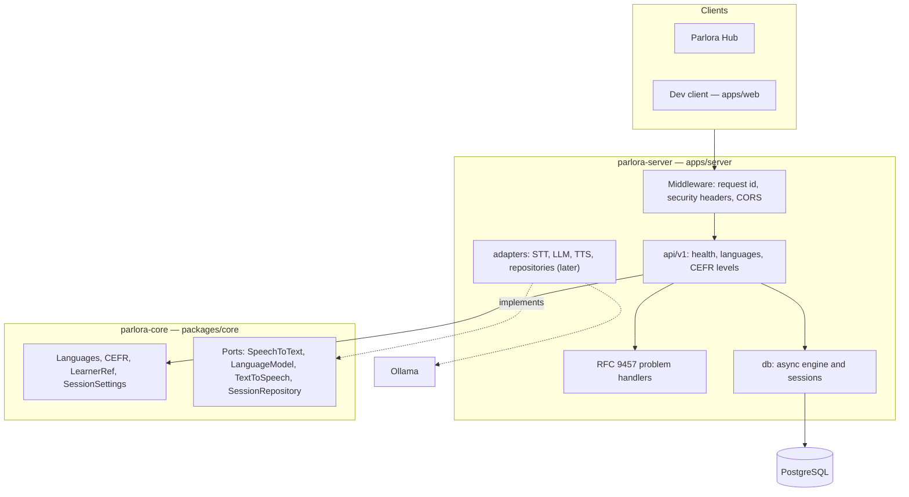

# Architecture

This page describes how Parlora Tutor is built today and where the pieces of
later phases will plug in. The reasons behind each choice are in the
[decision records](adr/).

## Role in Parlora

Parlora Tutor is the **voice-AI engine**: spoken conversation, written
corrections and, later, speaking and writing evaluation. It has no product
UI. **Parlora Hub**, the course platform, is the learner-facing product: it
owns accounts, lessons, progress, the mistakes notebook and spaced repetition,
and builds its own call screen on top of Tutor's API. `apps/web` is a
one-page dev client for development, testing and demos, not a second product.

## Components

| Part         | Package                  | Depends on                              |
| ------------ | ------------------------ | --------------------------------------- |
| Domain core  | `parlora-core`           | the Python standard library only        |
| Server       | `parlora-server`         | the core, FastAPI, SQLAlchemy, pydantic |
| Dev client   | `@parlora/web`           | the API contract (generated types)      |
| API contract | `contracts/openapi.json` | exported from the server                |

## Hexagonal layout

The domain core sits in the middle and knows nothing about HTTP, databases or
models ([ADR 0006](adr/0006-hexagonal-domain-core.md)):

- **Value objects** (`LanguageCode`, `Language`, `CefrLevel`, `LearnerRef`,
  `SessionSettings`) are frozen dataclasses that validate on construction and
  raise subclasses of `DomainError`.
- **Ports** in `parlora_core.ports` are `typing.Protocol`s for speech to text,
  the language model, text to speech and session storage. They are
  provisional until the voice loop (Phase 1) fixes their shape.
- **Adapters** in `parlora_server.adapters` implement the ports with real
  technology (faster-whisper, Ollama, Kokoro, PostgreSQL).

import-linter enforces both directions: the core may not import any framework
or the server, and inside the server `main` → `api` → `db` → `config` is a
strict layering.

## Language model

Languages are data, not code paths ([ADR 0007](adr/0007-language-as-a-first-class-concept.md)):

- A `LanguageCode` is a lowercase ISO 639-1 code. Accent and voice are a
  speech-synthesis concern, not part of a language's identity.
- Each `Language` declares its roles: **target** (the language the learner
  practises) and **feedback** (the language corrections are explained in).
- The `LanguageRegistry` is the single list of supported languages. Today it
  holds English (target and feedback) and Spanish (feedback only).
- `SessionSettings` combines a learner reference, target language, feedback
  language, CEFR level and topic, and validates the languages against their
  roles.
- When the learner has not chosen a feedback language, beginners (A1–A2) get
  it in their native language if that is a feedback language; everyone else
  gets it in the target language.
- The interface language is a separate concept. The dev client is English
  only; localised interfaces belong to Hub.

## Request flow

1. A request reaches the ASGI middleware, which accepts a valid inbound
   `X-Request-ID` or generates one, and adds it and the security headers to
   the response. CORS allows only the origins in `PARLORA_CORS_ORIGINS`.
2. A router under `/api/v1` validates input and calls the domain core.
3. The response is a JSON model from the contract. Any error — unknown route,
   wrong method, invalid input, unavailable dependency, unexpected failure —
   becomes an RFC 9457 problem document (`application/problem+json`) without
   stack traces or settings values.

The health endpoints follow the same path. `/api/v1/health/live` answers
while the process runs. `/api/v1/health/ready` runs every readiness check and
returns `checks`, an open map keyed by dependency: today only `database`;
Phase 1 adds the models. Clients must accept new keys.

## Persistence

PostgreSQL through SQLAlchemy 2 (async, asyncpg driver) with Alembic
migrations. The skeleton has only an empty baseline revision: no domain
tables yet. Integration tests run against a throwaway PostgreSQL container
(Testcontainers).

## Local runtime

`compose.yaml` runs PostgreSQL and the server; the language model runs in
Ollama on the host by default, or in the optional `ollama` profile.

- Published ports bind to `127.0.0.1` only: the server on **8700** and
  PostgreSQL on **5433**, so they do not collide with a Laravel app on 8000 or
  a PostgreSQL on 5432. Both are configurable.
- The Compose project is named `parlora`; the base file declares no external
  network or volume, so `just up` never depends on another project.
- The server reserves the NVIDIA GPU; `compose.nogpu.yaml` removes the
  reservation for CI and machines without one
  ([ADR 0002](adr/0002-server-gpu-runtime-in-docker.md)).
- WebRTC audio from the container works on the bridge network without
  publishing UDP ports for desktop browsers
  ([ADR 0003](adr/0003-webrtc-transport-from-docker.md)).

## Integration seams with the course platform

Tutor is built to be embedded in Parlora Hub without being tied to it. The
integration itself arrives in Phase 7; these rules hold from the start:

- **Each system owns its data.** Tutor stores conversations, keyed by
  learner reference. Hub stores identity, progress, the mistakes notebook and
  spaced repetition. Neither reads the other's database.
- **Opaque learner reference.** Hub generates one UUID per user and sends it
  as `learner_ref`. Tutor never receives names or email addresses; a
  `LearnerRef` rejects anything that looks like an email.
- **Contract-first API.** `contracts/openapi.json` is the integration surface
  Hub generates its client from, and problem documents are the error format
  it handles ([ADR 0008](adr/0008-contract-first-api.md)). A contract change
  lands in Tutor first, then in Hub. Results reach Hub through the API and,
  later, through signed webhooks; the call screen talks to Tutor over WebRTC
  with the RTVI message schema published in the contract.
- **Stand-alone mode.** Every integration feature is optional and off until
  configured, and Tutor runs fully on its own with the dev client. If Tutor
  is down, Hub keeps working; only calls and AI grading are unavailable.
- **Networking.** A later, optional Compose override attaches only the
  `server` service to a shared Docker network so Hub's containers reach it
  without more published ports. PostgreSQL never joins that network.
- **Authentication.** End-user identity stays with Hub. Service-to-service
  credentials (an API key, short-lived tokens for the voice channel, signed
  webhooks) arrive with the integration; while they are unset, integration
  endpoints stay disabled.

## Planned voice pipeline

From Phase 1, the server also runs a Pipecat pipeline per call: browser audio
over WebRTC → Silero VAD and turn detection → faster-whisper on the GPU → the
conversation model in Ollama → Kokoro speech synthesis on the CPU → back to
the browser. A second model call produces written corrections in parallel, so
they never delay the spoken reply. GPL code stays outside the process
([ADR 0004](adr/0004-kokoro-g2p-and-gpl-boundary.md)).
